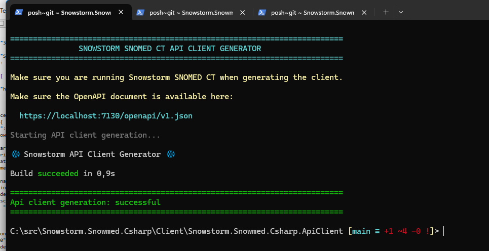

# Snowstorm.Snowmed.Csharp API client

This project contains a reusable C# client for the Minimal API in
`Snowstorm.Snowmed.Csharp.Client`. It is separate from the existing
`SnowstormClient`, which calls the upstream Snowstorm terminology server.

## Code generation

The easiest way of generating an updated API client is done in the following way:
- Run `dotnet run` on the `Snowstorm.Snowmed.Csharp.Client`
- Open up terminal for this project `Snowstorm.Snomed.Csharp.ApiClient` and then run the prepared CMD file 
- `GenerateSnomedApiClient.cmd`
- All done! 🚀



The client is generated from the Minimal API's OpenAPI document by
[NSwag.MSBuild](https://github.com/RicoSuter/NSwag/wiki/NSwag.MSBuild). The
generation settings are in [`nswag.json`](./nswag.json), and the generated
source is [`SnowstormApiClient.cs`](./SnowstormApiClient.cs).

The configuration reads an OpenAPI document URL, generates one typed client
with interfaces and DTOs, injects `HttpClient`, and uses `System.Text.Json`.
The DTOs are public C# records with constructor-based JSON deserialization.
Treat `SnowstormApiClient.cs` as generated code; do not edit it manually.

For example, construct a concept DTO with named constructor arguments:

```csharp
var concept = new ConceptResponse(
    conceptId: "73211009",
    name: "Diabetes mellitus");
```

## Regenerate the client

1. Start the Minimal API with the HTTPS launch profile:

   ```powershell
   dotnet run --project Client\Snowstorm.Snowmed.Csharp.Client --launch-profile https
   ```

2. From the repository root, run the generation target:

   ```powershell
   dotnet msbuild Client\Snowstorm.Snowmed.Csharp.ApiClient\Snowstorm.Snowmed.Csharp.ApiClient.csproj /t:GenerateApiClient
   ```

By default, the target reads `https://localhost:7130/openapi/v1.json`. To use
another host or port, pass the `OpenApiUrl` MSBuild property:

```powershell
dotnet msbuild Client\Snowstorm.Snowmed.Csharp.ApiClient\Snowstorm.Snowmed.Csharp.ApiClient.csproj /t:GenerateApiClient /p:OpenApiUrl=https://localhost:7130/openapi/v1.json
```

Generation is an explicit target, so normal builds use the checked-in generated
source and do not require the API to be running.

## Consume the client

Add a project reference to this library, then configure the generated client
with the API's base URL:

```powershell
dotnet add <consumer-project.csproj> reference Client\Snowstorm.Snowmed.Csharp.ApiClient\Snowstorm.Snowmed.Csharp.ApiClient.csproj
```

```csharp
builder.Services.AddHttpClient<ISnowstormApiClient, SnowstormApiClient>(client =>
{
    client.BaseAddress = new Uri("https://localhost:7130/");
});
```

The client exposes operations such as `SearchConceptsAsync` and
`GetConceptByIdAsync`.
